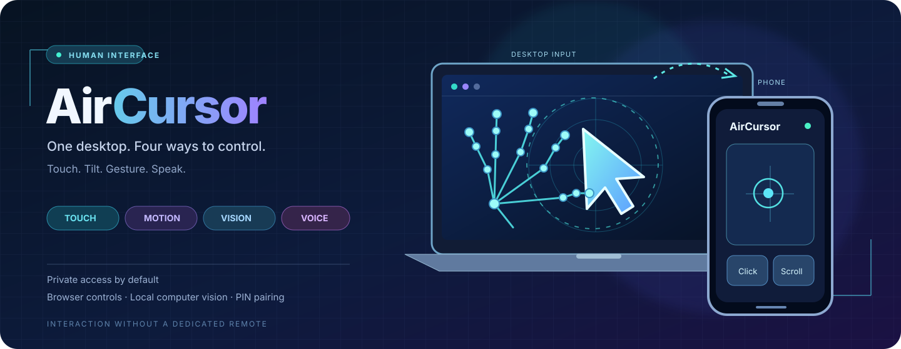
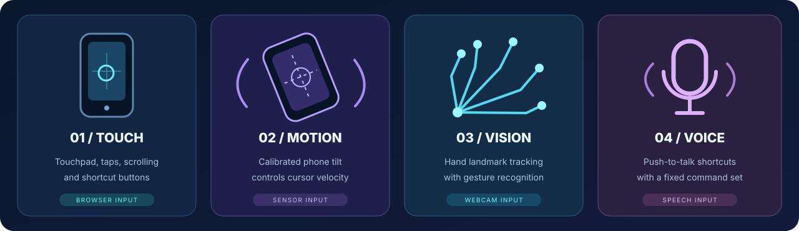

# AirCursor

### A multi-modal desktop interaction system

**Control a computer using a phone touchpad, phone orientation, hand gestures, or voice shortcuts — through one thoughtfully constrained desktop-control architecture.**

  
  
  

  
  
  
  
  
  
  

**Four input modes** &nbsp;·&nbsp; **One browser dashboard** &nbsp;·&nbsp; **PIN-protected control API** &nbsp;·&nbsp; **Private-network-first design**

[Features](#capabilities-at-a-glance) · [How it works](#how-aircursor-works) · [Installation](#quick-start) · [API](#rest-api-reference) · [Troubleshooting](#troubleshooting)

---

## Overview

AirCursor is a desktop interaction system that translates different human inputs into the same familiar computer actions: **pointer movement, clicks, scrolling, media shortcuts, and presentation navigation**.

Instead of treating a mouse as the only way to interact with a computer, AirCursor provides multiple input surfaces:

- **Phone touchpad:** use a mobile browser as a trackpad with tap, long-press, double-click, two-finger scroll, and dedicated controls.
- **Phone motion:** calibrate a neutral position and tilt the device to control cursor movement using orientation sensor readings.
- **Webcam gestures:** track one hand locally, transform landmarks into pointer coordinates, and recognize pinch and scroll gestures.
- **Voice shortcuts:** speak supported commands using a push-to-talk browser interface; only predefined actions are accepted.

The phone interface communicates with a small Python/Flask service running on the computer. That service validates the session and translates approved requests into operating-system mouse or keyboard actions through PyAutoGUI. **Webcam gesture processing is a separate, locally launched process**; the phone dashboard does not turn on the computer's camera.

> **Design principle:** different input methods, consistent desktop behavior — with explicit pairing, limited commands, and no arbitrary remote shell execution.

### What problem does it solve?

Traditional computer interaction often assumes a nearby keyboard and mouse. That assumption breaks down during presentations, media playback across a room, demonstrations, experiments with spatial interaction, or situations where a conventional input device is inconvenient.

AirCursor addresses those use cases without requiring a dedicated hardware remote, a custom native phone app, or a full remote-desktop streaming system. The user chooses the control method that fits the task while the computer remains the authority that executes approved input events.

### What AirCursor is — and is not

| AirCursor provides | AirCursor does not provide |
|:--|:--|
| Browser-based pointer and shortcut control | A streamed remote desktop or screen-sharing session |
| Optional local webcam hand tracking | A remotely activated webcam |
| Private HTTPS control through Tailscale Serve | An internet-facing public control server |
| A narrowly defined action API | Arbitrary command, script, or terminal execution |
| Browser-stored preferences | A cloud account or synchronized user profile |
| Local input automation | Guaranteed performance across all phones or cameras |

---

## Capabilities at a glance

| Capability | Input source | Processing | Result |
|:--|:--|:--|:--|
| **Touchpad** | Mobile browser pointer/touch events | Delta accumulation, adjustable sensitivity, tap/hold mapping | Cursor movement, clicks, scrolling |
| **Motion control** | DeviceOrientation pitch/roll readings | Calibration, dead zone, sensitivity scaling, clamping | Tilt-directed relative cursor movement |
| **Hand tracking** | Computer's local webcam | OpenCV frames, MediaPipe landmarks, gesture rules, smoothing | Point, click, right-click, scroll |
| **Voice** | Browser microphone and speech recognition | Exact-phrase allowlist and API dispatch | Slides, media, volume, click, scroll |
| **Presentation/media panel** | Browser dashboard buttons | Named action allowlist | Next/previous slide, play/pause, volume, mute, Escape, Enter |
| **Access profiles** | Browser settings | Local preferences and UI styling | Larger controls, higher contrast, reduced effects, sensitivity presets |
| **Pairing** | Short PIN shown on the computer | Time-limited session cookie and server checks | Authorized control session |

## Contents

1. [System architecture](#system-architecture)
2. [How AirCursor works](#how-aircursor-works)
3. [Quick start](#quick-start)
4. [Connection options](#connection-options)
5. [Phone touchpad](#phone-touchpad)
6. [Motion-based air mouse](#motion-based-air-mouse)
7. [Webcam hand gestures](#webcam-hand-gestures)
8. [Voice and presentation controls](#voice-and-presentation-controls)
9. [Security model](#security-model)
10. [REST API reference](#rest-api-reference)
11. [Configuration](#configuration)
12. [Tech stack](#technology-stack)
13. [Repository structure](#repository-structure)
14. [Building for Windows](#building-for-windows)
15. [Testing and validation](#testing-and-validation)
16. [Troubleshooting](#troubleshooting)
17. [Practical use cases](#practical-use-cases)
18. [Limitations and compatibility](#limitations-and-compatibility)
19. [License](#license)

---

## System architecture

AirCursor separates **input collection**, **input interpretation**, **authorization**, and **desktop actuation**. This makes it easier to reason about how a browser gesture, phone sensor reading, or spoken command becomes a mouse or keyboard event.

### High-level component diagram

~~~mermaid
flowchart LR
  subgraph P["PHONE · WEB BROWSER"]
    T["Touchpad & buttons"]
    M["Orientation sensors"]
    V["Speech recognition"]
    UI["Settings & profiles"]
    T --> F["Browser command layer"]
    M --> F
    V --> F
    UI -.-> F
  end

  subgraph N["PRIVATE TRANSPORT"]
    L["Trusted local Wi-Fi / HTTP"]
    H["Tailscale Serve / HTTPS"]
  end

  subgraph S["COMPUTER · FLASK SERVER"]
    WEB["Dashboard & static assets"]
    PIN["PIN pairing"]
    AUTH["Session + origin checks"]
    API["Constrained REST endpoints"]
    INPUT["AirMouse / PyAutoGUI"]
    WEB --> PIN --> AUTH --> API --> INPUT
  end

  subgraph C["COMPUTER · OPTIONAL LOCAL PROCESS"]
    CAM["Webcam / OpenCV"]
    MP["MediaPipe Hands"]
    GEST["Gesture rules + smoothing"]
    LOCAL["PyAutoGUI"]
    CAM --> MP --> GEST --> LOCAL
  end

  F --> L --> AUTH
  F --> H --> AUTH
  INPUT --> OS["Desktop cursor / shortcuts"]
  LOCAL --> OS

  classDef source fill:#173B56,stroke:#54D2E5,color:#E7FAFF;
  classDef transport fill:#343066,stroke:#ADA0FF,color:#F6F2FF;
  classDef server fill:#153C3A,stroke:#63D9BA,color:#E7FFF7;
  classDef local fill:#253B60,stroke:#7FB0FF,color:#F0F7FF;
  classDef result fill:#0E3C50,stroke:#54E3DC,color:#FFFFFF;
  class T,M,V,UI,F source;
  class L,H transport;
  class WEB,PIN,AUTH,API,INPUT server;
  class CAM,MP,GEST,LOCAL local;
  class OS result;
~~~

**Important architectural boundary:** the remote browser goes through Flask's authenticated REST API. The webcam controller does **not** depend on that API; it is intentionally launched and operated on the computer itself.

### Logical layers

| Layer | Responsibility | Implementation |
|:--|:--|:--|
| Interface | Responsive controls and device feedback | HTML, CSS, JavaScript |
| Input processing | Touch deltas, tilt mapping, gesture detection, phrase parsing | JavaScript, OpenCV, MediaPipe |
| Transport | Same-origin browser requests to the local computer | HTTP on trusted LAN; HTTPS through Tailscale Serve |
| Authentication | Pairing, session expiry, input restrictions | Flask server |
| Command routing | Convert approved requests into known actions | REST endpoints and allowlisted actions |
| Actuation | Move pointer, click, scroll, press supported keys | PyAutoGUI |
| Packaging | Source checkout, Windows executable and installer | setuptools, PyInstaller, Inno Setup, GitHub Actions |

---

## How AirCursor works

### End-to-end control lifecycle

~~~mermaid
sequenceDiagram
    autonumber
    actor U as User
    participant B as Phone browser
    participant S as Flask server
    participant A as AirMouse / PyAutoGUI
    participant D as Desktop

    U->>S: Launch AirCursor on computer
    S-->>U: Display pairing PIN and URL
    U->>B: Open dashboard and enter PIN
    B->>S: POST /api/v1/pair
    S->>S: Validate PIN and rate limit
    alt Valid PIN
        S-->>B: Time-limited, HttpOnly session cookie
        U->>B: Swipe, tap, tilt, or speak
        B->>S: Approved API request + session cookie
        S->>S: Validate session, origin, and input
        S->>A: Invoke allowlisted mouse/key operation
        A->>D: Execute desktop input
        S-->>B: JSON result
    else Invalid PIN
        S-->>B: Pairing error or temporary lockout
    end
    opt Session ends
        U->>B: Log out
        B->>S: POST /api/v1/logout
        S->>S: Revoke session
    end
~~~

This workflow distinguishes three concerns: **permission to control the computer**, **the meaning of an input event**, and **the resulting operating-system action**. A successful pairing is necessary but does not grant arbitrary system commands.

### Input-to-action routing

~~~mermaid
flowchart TD
  START(["New input event"]) --> TYPE{"Which source?"}
  TYPE -->|Phone swipe| DELTA["Compute pointer delta"]
  TYPE -->|Phone tilt| ANGLE["Calibrate + map orientation"]
  TYPE -->|Phone tap/button| MAP["Resolve click or shortcut"]
  TYPE -->|Voice phrase| VOICE["Match supported phrase"]
  TYPE -->|Local webcam| HAND["Detect hand landmarks"]

  DELTA --> REQ["Browser REST request"]
  ANGLE --> REQ
  MAP --> REQ
  VOICE --> REQ
  REQ --> CHECK{"Paired + valid request?"}
  CHECK -->|No| REJECT["Reject safely"]
  CHECK -->|Yes| OS["OS mouse / keyboard action"]

  HAND --> RULES["Evaluate gesture rules"]
  RULES --> DIRECT["Local PyAutoGUI action"]

  classDef input fill:#172D59,stroke:#79ABFD,color:#FFFFFF;
  classDef check fill:#483A6E,stroke:#BBA2FF,color:#FFFFFF;
  classDef good fill:#17483F,stroke:#65DFC0,color:#FFFFFF;
  classDef bad fill:#4B2638,stroke:#F69CB6,color:#FFFFFF;
  class START,TYPE,DELTA,ANGLE,MAP,VOICE,HAND input;
  class CHECK,RULES check;
  class OS,DIRECT good;
  class REJECT bad;
~~~

---

## Quick start

### Prerequisites

| Component | Requirement |
|:--|:--|
| Computer | Windows desktop or laptop for the documented setup |
| Python | Python **3.11 recommended**; package metadata allows Python 3.9+ |
| Package manager | pip |
| Mobile control | Phone with a modern browser |
| Same-network mode | Both devices on a trusted private Wi-Fi network |
| Webcam gestures | A functioning webcam and additional vision dependencies |
| Phone motion / voice | Browser support and a trusted HTTPS context, preferably Tailscale Serve |

### 1. Clone the repository

~~~powershell
git clone https://github.com/pushkkal0201-bit/Air_Cursor.git
cd Air_Cursor
~~~

### 2. Create a Python environment

Run the following in **Windows Command Prompt**:

~~~bat
py -3.11 -m venv .venv
.venv\Scripts\activate
python -m pip install --upgrade pip
python -m pip install -r requirements.txt
~~~

The main requirements install the Flask server, PyAutoGUI input control, QR-code generation, and image support. The optional computer-vision packages are installed separately.

### 3. Start AirCursor

**Local computer only (default):**

~~~bat
python app.py
~~~

Open **http://127.0.0.1:5055** on the computer.

**Phone touchpad on trusted private Wi-Fi:**

~~~bat
python app.py --lan
~~~

Open the local network address shown in the AirCursor dashboard on the phone, or scan the displayed QR code.

### 4. Pair the phone

1. Keep the AirCursor terminal visible on the computer.
2. Read the **six-digit pairing PIN** printed in the terminal.
3. Open the dashboard address from your phone.
4. Enter the PIN and select **Pair**.
5. Use the touchpad, click buttons, and presentation controls.

**Do not post the PIN publicly.** The PIN changes when the server starts unless it has been explicitly configured otherwise.

### 5. Stop the service

Press **Ctrl+C** in the computer terminal. Closing the server ends its availability; logging out in the browser explicitly revokes the current session.

---

## Connection options

AirCursor supports distinct transport modes rather than treating all network access as equivalent.

| Mode | Run command | Who can reach it? | Best for | Important detail |
|:--|:--|:--|:--|:--|
| **Local-only** | `python app.py` | Browser on the same computer | Testing and demonstrations | Binds to `127.0.0.1` by default |
| **Trusted Wi-Fi** | `python app.py --lan` | Devices allowed onto the private LAN | Phone touchpad and buttons | Plain HTTP is **not encrypted** |
| **Private tailnet HTTPS** | `python app.py --tailscale-host HOST` | Devices allowed by your Tailscale access controls | Phone touch, motion, voice | Tailscale Serve terminates HTTPS; backend remains localhost-only |
| **Development HTTPS** | `python app.py --https` | Depends on binding | Local TLS experimentation | Self-signed certificate is not automatically trusted |

### Configure private Tailscale HTTPS

Phone orientation sensors and browser microphone APIs commonly require a **secure context**. A private Tailscale Serve endpoint provides an HTTPS URL without requiring internet-facing port forwarding.

**First-time setup:**

1. Install and connect [Tailscale](https://tailscale.com/download) on the Windows computer and phone, using an authorized tailnet.
2. Enable Tailscale Serve / HTTPS support if prompted.
3. In one Command Prompt window on the computer, run:

~~~bat
tailscale serve --bg 5055
tailscale serve status
~~~

4. Copy the exact **device hostname** shown in the Serve URL (omit `https://` and any trailing slash).
5. Start the AirCursor server in a separate terminal:

~~~bat
.venv\Scripts\activate
python app.py --tailscale-host YOUR-DEVICE.YOUR-TAILNET.ts.net
~~~

6. On the connected phone, open the HTTPS URL from Tailscale, pair with the computer's PIN, and use the dashboard.
7. For **Motion-based air mouse**, press **Enable motion**, accept the browser permission request if shown, calibrate, and tilt the phone.

**Mode restrictions:** do not combine `--tailscale-host` with `--lan`, `--host`, or `--https`. In Tailscale mode the Flask application binds to `127.0.0.1` and accepts only the explicitly configured Tailscale hostname behind the trusted proxy.

**To disable Serve**, review `tailscale serve status` and turn off the endpoint when no longer needed:

~~~bat
tailscale serve --https=443 off
~~~

Use **Serve**, not **Funnel**. Do not set up public port forwarding. A PIN is an authentication measure, not a replacement for transport encryption.

---

## Phone touchpad

The dashboard turns a touchscreen into a configurable relative-pointer device. Input is interpreted in the browser and forwarded as small, authenticated movement requests.

### Supported interactions

| Interaction | Behavior |
|:--|:--|
| Drag one finger | Move the desktop pointer relative to finger movement |
| Single tap | Perform the configured tap action |
| Double tap | Perform a double click |
| Long press | Perform the configured hold action |
| Two-finger vertical movement | Scroll vertically |
| Left / right / double buttons | Execute explicit click actions |
| Shortcut buttons | Send a predefined presentation or media command |

A local sensitivity setting scales touch displacement before the command is sent. Fractional movements are accumulated and rounded rather than independently discarded; browser requests are queued so that overlapping pointer updates do not flood the server.

### Touchpad processing pipeline

~~~mermaid
flowchart LR
  DOWN["Pointer / touch event"] --> MODE{"Gesture?"}
  MODE -->|Drag| DIFF["Calculate dx / dy"]
  DIFF --> GAIN["Apply sensitivity"]
  GAIN --> BUFFER["Accumulate + clamp deltas"]
  BUFFER --> PATCH["PATCH /api/v1/cursor"]
  MODE -->|Tap or hold| CLICK["Resolve chosen action"]
  CLICK --> POST["POST /api/v1/click"]
  MODE -->|Two-finger scroll| SCROLL["Compute vertical scroll steps"]
  SCROLL --> PS["POST /api/v1/scroll"]
  PATCH --> PY["Validate session & move pointer"]
  POST --> PY
  PS --> PY
  classDef io fill:#1C3560,stroke:#83B2FF,color:#FFFFFF;
  classDef compute fill:#3D3268,stroke:#B9A0FF,color:#FFFFFF;
  classDef api fill:#154D47,stroke:#67DEC2,color:#FFFFFF;
  class DOWN,MODE io;
  class DIFF,GAIN,BUFFER,CLICK,SCROLL compute;
  class PATCH,POST,PS,PY api;
~~~

**Preferences:** touch sensitivity, tap mapping, hold mapping, and motion speed are saved in the **phone browser's local storage**. They are not synchronized to a server-side account.

---

## Motion-based air mouse

AirCursor can use a compatible phone's orientation sensors as a pointing device. Unlike touch input, motion mode derives cursor velocity from the difference between the current device orientation and a saved neutral position.

### Data path

~~~mermaid
flowchart TD
  A["Enable motion in secure browser"] --> B{"Sensor supported / permitted?"}
  B -->|No| C["Show permission or compatibility feedback"]
  B -->|Yes| D["Listen for DeviceOrientation events"]
  D --> E["Capture neutral beta / gamma"]
  E --> F["Read current beta / gamma"]
  F --> G["Subtract neutral orientation"]
  G --> H["Apply ±2° dead zone"]
  H --> I["Scale by motion sensitivity"]
  I --> J["Clamp & round per-axis movement"]
  J --> K["Queue relative cursor API request"]
  K --> F
  F -->|Recalibrate| E
  F -->|Stop / hide page| L["Stop motion listener"]

  classDef device fill:#213C62,stroke:#8CBCFF,color:#FFFFFF;
  classDef math fill:#3B316B,stroke:#BEA5FF,color:#FFFFFF;
  classDef control fill:#174D43,stroke:#76E5C2,color:#FFFFFF;
  classDef warn fill:#522C48,stroke:#EF9DBC,color:#FFFFFF;
  class A,B,D,E,F device;
  class G,H,I,J math;
  class K,L control;
  class C warn;
~~~

### Pointer mapping

For each supported axis, the browser computes:

\[
\Delta \theta = \theta_{\text{current}} - \theta_{\text{neutral}}
\]

\[
m = \operatorname{round}\left(
\operatorname{clamp}\left(
\operatorname{sgn}(\Delta\theta)
\cdot \max(|\Delta\theta|-2,0)
\cdot 0.25s,\;-28,\;28
\right)\right)
\]

where **`s`** is the selected motion sensitivity, **`2°`** is the dead zone that suppresses small orientation changes, and **`m`** is the relative cursor movement sent on that axis.

Implementation details:

- **Calibration:** the first valid sensor reading establishes the neutral orientation.
- **Recalibration:** the dashboard can reset the neutral position at any time.
- **Dead zone:** movement within approximately ±2° is ignored.
- **Rate limiting:** the browser processes motion-driven movement at intervals of at least 45 ms.
- **Bounds:** each computed axis step is constrained before dispatch.
- **Session behavior:** hiding the page, leaving it, or unpairing stops the motion listener.

The movement model intentionally uses simple, inspectable math rather than a hidden predictive model.

**Browser requirement:** a secure HTTPS context and device-specific sensor permissions may be necessary. A phone's ordinary private Wi-Fi `http://` URL generally does **not** provide the secure context needed for this feature.

---

## Webcam hand gestures

The webcam controller is an **optional local application**. It uses OpenCV to capture frames, MediaPipe Hands to estimate one hand's landmarks, and gesture rules to invoke desktop input actions.

### Start gesture mode

~~~bat
python -m pip install -r requirements-vision.txt
python gesture_control.py
~~~

A local webcam window displays the live image, tracked landmark overlay, and recognized action. Press **Q** or **Esc** to close it.

### Gesture reference

| Hand pose | Default action | How it is interpreted |
|:--|:--|:--|
| Index finger extended | **Move cursor** | Index fingertip coordinates map to desktop space |
| Thumb + index finger pinch | **Left click** | Fingertip distance below palm-normalized threshold |
| Thumb + middle finger pinch | **Right click** | Alternate pinch under the same threshold logic |
| Index + middle fingers extended, moved vertically | **Scroll** | Vertical displacement of the two fingertips |
| Point steadily for a configured duration | **Dwell click** | Optional, disabled by default |

### Computer-vision pipeline

~~~mermaid
flowchart TD
  CAM["Local webcam frame"] --> FLIP["Mirror frame; convert BGR to RGB"]
  FLIP --> MP["MediaPipe Hands: landmark estimation"]
  MP --> FOUND{"Hand landmarks found?"}
  FOUND -->|No| RESET["Reset tracking / dwell state"]
  FOUND -->|Yes| PALM["Estimate palm scale"]
  PALM --> CLASS{"Recognized hand pose?"}
  CLASS -->|Thumb-index pinch| LEFT["Configured index-pinch action"]
  CLASS -->|Thumb-middle pinch| RIGHT["Configured middle-pinch action"]
  CLASS -->|Two-finger pose| SCROLL["Vertical scroll accumulator"]
  CLASS -->|One-finger point| MOVE["Landmark-to-screen mapping"]
  MOVE --> SMOOTH["Exponential smoothing + movement dead zone"]
  SMOOTH --> DWELL{"Optional dwell condition?"}
  DWELL -->|Yes| DC["Single dwell click"]
  DWELL -->|No| CURSOR["Move cursor"]
  LEFT --> OS["PyAutoGUI desktop input"]
  RIGHT --> OS
  SCROLL --> OS
  DC --> OS
  CURSOR --> OS

  classDef capture fill:#1A3C5C,stroke:#74B9FF,color:#FFFFFF;
  classDef detection fill:#392F67,stroke:#B4A2FD,color:#FFFFFF;
  classDef control fill:#13483F,stroke:#69E0BE,color:#FFFFFF;
  class CAM,FLIP,MP,FOUND,PALM capture;
  class CLASS,SMOOTH,DWELL detection;
  class LEFT,RIGHT,SCROLL,MOVE,DC,CURSOR,OS,RESET control;
~~~

### Landmark geometry and smoothing

**Palm normalization.** Pinch distances are compared with a reference span of hand landmarks instead of a fixed number of pixels. This reduces dependence on the hand's apparent size in the video frame.

**Pointer smoothing.** Let `p_t` be the new fingertip-derived target coordinate and `q_t` the smoothed cursor target:

\[
q_t = q_{t-1} + \alpha(p_t - q_{t-1})
\]

The default **`α = 0.28`** reduces abrupt pointer changes. A separate movement dead zone (default **3 pixels**) avoids sending imperceptibly small moves.

**Dwell input.** When enabled, a steady pointing fingertip held inside a configured radius for a configured interval can trigger one left click; leaving that region resets the tracker. This is **off by default** to reduce accidental clicks.

**Local safety boundary.** Camera capture does not start from the remote browser. Camera frames are processed locally by the gesture controller rather than being transmitted through the phone-control API.

---

## Voice and presentation controls

AirCursor provides a **push-to-talk, single-command** voice interface in browsers that support speech recognition. Instead of executing arbitrary recognized words, the browser normalizes the transcript and checks it against an explicit supported-phrase set.

### Voice-command flow

~~~mermaid
flowchart LR
  MIC["User chooses Listen"] --> SEC{"Secure context + speech API?"}
  SEC -->|No| WARN["Show unavailable message"]
  SEC -->|Yes| REC["Capture one recognition result"]
  REC --> NORM["Normalize transcript"]
  NORM --> MATCH{"Exact phrase supported?"}
  MATCH -->|No| IGNORE["Ignore input"]
  MATCH -->|Yes| MAP["Map to named action / click / scroll"]
  MAP --> API["Authenticated REST request"]
  API --> SYS["Allowed desktop operation"]
  classDef mic fill:#1B3C62,stroke:#87C5FF,color:#FFFFFF;
  classDef gate fill:#413468,stroke:#C4A5FF,color:#FFFFFF;
  classDef success fill:#174C44,stroke:#6BE1C3,color:#FFFFFF;
  classDef stop fill:#4D293D,stroke:#EF9DB5,color:#FFFFFF;
  class MIC,REC,NORM mic;
  class SEC,MATCH gate;
  class MAP,API,SYS success;
  class WARN,IGNORE stop;
~~~

### Supported speech phrases

| Action group | Example recognized phrases |
|:--|:--|
| Slides | `next slide`, `previous slide`, `next page`, `previous page` |
| Playback | `play pause`, `pause video`, `resume video` |
| Volume | `volume up`, `volume down`, `mute`, `unmute` |
| Mouse | `left click`, `right click`, `double click` |
| Scroll | `scroll up`, `scroll down` |
| Navigation | `escape`, `enter` |

The browser accepts only recognized phrases from its allowlist; the server independently checks allowed action names. Voice input does not grant command-line access.

**Privacy note:** AirCursor itself does not store microphone recordings or transcripts on the Flask server. Depending on the browser, however, the browser's speech-recognition service **may use remote/cloud processing**. Review the browser's own privacy behavior before enabling voice input.

### Presentation and media shortcuts

The browser dashboard also exposes named buttons for navigation and media playback. Supported server actions are:

`next_slide` · `previous_slide` · `play_pause` · `volume_up` · `volume_down` · `mute` · `escape` · `enter`

These resolve to known key events, not free-form keyboard sequences.

---

## Accessibility and control profiles

The dashboard provides adjustment presets to support different interaction preferences.

| Profile | Intended interaction | UI characteristics |
|:--|:--|:--|
| **Standard** | Everyday pointer use | Default sensitivity and controls |
| **Comfort** | Easier-to-target controls | Larger buttons and high contrast |
| **Precision** | Finer movement | Lower sensitivity and reduced effects |
| **Presentation** | Control from a distance | Larger controls and higher cursor sensitivity |

Large controls, high contrast, and reduced visual effects can also be adjusted individually. These settings remain in the current browser's local storage.

These are convenience and usability options, **not certified assistive-technology or medical accessibility guarantees**.

---

## Security model

AirCursor can generate real mouse and keyboard events on the host machine. The security model is therefore part of the product architecture, not an optional afterthought.

### Pairing/session state

~~~mermaid
stateDiagram-v2
  [*] --> Unpaired
  Unpaired --> Pairing: Submit computer PIN
  Pairing --> Paired: Valid PIN + session created
  Pairing --> Unpaired: Invalid PIN
  Pairing --> Limited: Too many failed attempts
  Limited --> Unpaired: Lockout window ends
  Paired --> Paired: Valid permitted command
  Paired --> Unpaired: Log out
  Paired --> Unpaired: Session expires
  Paired --> Unpaired: Server stops / restarts
~~~

### Implemented safeguards

| Control | Behavior |
|:--|:--|
| **Default binding** | Server listens on localhost unless LAN is explicitly requested or another host is configured |
| **PIN pairing** | Six-digit PIN generated at startup by default |
| **Pairing rate limit** | Up to five failed attempts per source IP in a two-minute window |
| **Session lifetime** | Session cookies expire after one hour |
| **Session cap** | Maximum of 16 live sessions |
| **Cookie restrictions** | `HttpOnly` and `SameSite=Strict`; `Secure` flag on HTTPS responses |
| **Session validation** | In-memory token checked with expiry and client IP association |
| **Request origin** | State-changing protected endpoints enforce same-origin checks |
| **Client header** | Write requests require `X-AirCursor-Client: 1` |
| **Input constraints** | JSON size limited to 2 KiB; numeric ranges, mouse buttons, and actions validated |
| **Host restrictions** | Loopback/private IP hosts accepted; trusted Tailscale hostname must be explicitly configured |
| **Browser policy** | Restrictive Content Security Policy and defensive response headers |
| **OS input fail-safe** | PyAutoGUI corner fail-safe enabled |
| **Command surface** | Named mouse/keyboard actions only — no general shell execution |

### Threat boundaries to understand

1. **A PIN does not encrypt HTTP.** Plain LAN access may expose traffic to someone who can observe the local network. Use trusted private Wi-Fi only; prefer private HTTPS where available.
2. **Tailscale Serve is private, not public.** Tailnet members permitted by its access rules can reach the pairing page. Keep your device access controls current and do not enable Funnel.
3. **IP-bound sessions are a defense-in-depth measure.** They do not make an untrusted network safe.
4. **Browser voice services may process audio externally.** That behavior is independent of the local Flask API.
5. **Desktop automation has real effects.** Only run the application on machines you own or are authorized to control.

---

## REST API reference

The browser dashboard is a client of a small JSON API. Most endpoints require a valid paired-session cookie, and state-changing requests additionally require the client header and origin checks.

### Authentication and headers

For a state-changing request:

~~~http
Content-Type: application/json
X-AirCursor-Client: 1
Cookie: aircursor_session=<session-cookie-managed-by-browser>
~~~

The browser manages the `HttpOnly` session cookie; application JavaScript does not read it.

### Endpoints

| Method | Route | Purpose | Request example |
|:--|:--|:--|:--|
| `GET` | `/api/v1/status` | Read pairing state; public | — |
| `POST` | `/api/v1/pair` | Submit computer PIN | `{"pin":"123456"}` |
| `POST` | `/api/v1/logout` | Revoke current session | `{}` |
| `GET` | `/api/v1/cursor` | Read cursor coordinates | — |
| `PUT` | `/api/v1/cursor` | Set absolute cursor position | `{"x":500,"y":300}` |
| `PATCH` | `/api/v1/cursor` | Move cursor relatively | `{"dx":10,"dy":-4}` |
| `POST` | `/api/v1/click` | Mouse click | `{"button":"left","count":1}` |
| `POST` | `/api/v1/scroll` | Scroll pointer | `{"dy":-2}` |
| `POST` | `/api/v1/action` | Named keyboard/media shortcut | `{"action":"next_slide"}` |

The sample PIN is illustrative and is **not** a credential to reuse. Only the currently displayed server PIN will pair successfully.

### Example: relative cursor movement

~~~http
PATCH /api/v1/cursor HTTP/1.1
Content-Type: application/json
X-AirCursor-Client: 1

{"dx":12,"dy":-8}
~~~

Successful response:

~~~json
{"x":512,"y":292}
~~~

The position above is illustrative; the actual coordinates depend on the current desktop pointer position.

### Request validation and failure responses

| Status | Typical meaning |
|:--|:--|
| `400` | Invalid JSON, out-of-range numeric input, or unsupported action |
| `401` | Missing/expired pairing or incorrect PIN |
| `403` | Missing client header or invalid request origin |
| `421` | Untrusted `Host` header |
| `429` | Too many pairing attempts |
| `503` | Maximum simultaneous sessions reached |

**API design choices:** movement values are bounded, mouse button names are enumerated, action names are explicit, and requests are intentionally small. This is an input-control API, **not a general remote execution API**.

---

## Configuration

### Launch options

~~~text
python app.py [--lan | --local-only] [--host ADDRESS]
              [--port PORT] [--tailscale-host DEVICE.TAILNET.TS.NET]
              [--https] [--version]
~~~

| Option | Description |
|:--|:--|
| `--local-only` | Explicitly bind to `127.0.0.1` |
| `--lan` | Listen on the LAN interface, intended only for trusted private networks |
| `--host ADDRESS` | Advanced binding override; do not expose to public networks |
| `--port PORT` | Choose port (default `5055`) |
| `--tailscale-host HOST` | Explicit, exact Tailscale Serve hostname; keeps Flask on localhost |
| `--https` | Development-only self-signed HTTPS mode |
| `--version` | Display installed application version without starting the server |

Environment variables include `AIRCURSOR_HOST`, `AIRCURSOR_PORT`, `AIRCURSOR_HTTPS`, and `AIRCURSOR_PAIRING_PIN`. For ordinary use, prefer the generated pairing PIN instead of storing a fixed PIN in shell history or project files.

### Webcam gesture configuration

Gesture settings are read from `gesture_config.json`:

~~~json
{
  "camera": 0,
  "smoothing": 0.28,
  "pinch_threshold": 0.32,
  "scroll_speed": 24,
  "gesture_actions": {
    "index_pinch": "left_click",
    "middle_pinch": "right_click"
  },
  "deadzone_pixels": 3,
  "dwell_click_seconds": 0,
  "dwell_radius": 0.018
}
~~~

| Setting | Meaning |
|:--|:--|
| `camera` | Camera device index |
| `smoothing` | Exponential pointer smoothing coefficient |
| `pinch_threshold` | Palm-relative fingertip distance threshold |
| `scroll_speed` | Scale applied to two-finger vertical scroll |
| `gesture_actions` | Mapping for index and middle pinch |
| `deadzone_pixels` | Ignore very small cursor changes |
| `dwell_click_seconds` | Dwell-click delay; `0` disables it |
| `dwell_radius` | Maximum tolerated movement during dwell |

Allowed custom pinch actions: `left_click`, `right_click`, `double_click`, `middle_click`, and `none`.

Launch with an alternate configuration file:

~~~bat
python gesture_control.py --config custom-gesture-settings.json
~~~

### Local browser preferences

| Preference | Where it is stored |
|:--|:--|
| Touch sensitivity and tap/hold mapping | Phone browser local storage |
| Motion sensitivity | Phone browser local storage |
| Comfort/precision/presentation profile | Phone browser local storage |
| High contrast, large controls, reduced effects | Phone browser local storage |

Reinstalling the Python service does not automatically synchronize these preferences to other browsers or phones.

---

## Technology stack

| Area | Technology | Why it is used |
|:--|:--|:--|
| Backend service | **Python + Flask** | HTTP routes, pairing, request validation, JSON responses |
| Desktop input | **PyAutoGUI** | Cursor position/movement, clicks, scrolling, key presses |
| Web UI | **HTML + CSS + JavaScript** | Mobile controls, settings, browser sensor and microphone access |
| Gesture perception | **OpenCV** | Local webcam frame capture and visual overlays |
| Hand landmark estimation | **MediaPipe Hands** | Hand keypoint detection for gesture rules |
| Sensor processing | **DeviceOrientation API** | Phone orientation readings |
| Voice input | **Web Speech recognition APIs** | One-shot speech-to-text in supported browsers |
| Device onboarding | **qrcode + Pillow** | Render a QR code for the configured connection URL |
| Private HTTPS | **Tailscale Serve** | Tailnet-scoped HTTPS reverse proxy |
| Packaging | **setuptools + PyInstaller + Inno Setup** | Installable Python package and Windows distribution |
| Quality checks | **pytest, Node.js tests, GitHub Actions** | API/security tests, browser logic tests, builds |

**Dependency note:** the optional vision dependency is pinned to a MediaPipe release that still provides the `mp.solutions` Hands API used by the webcam controller. Python 3.11 is recommended for that workflow.

---

## Repository structure

~~~text
Air_Cursor/
├── app.py                           # Source checkout launcher
├── run_aircursor.py                 # Packaged executable launcher
├── gesture_control.py               # Local webcam gesture controller
├── gesture_config.json              # Webcam gesture and smoothing settings
├── requirements.txt                 # Core Python dependencies
├── requirements-vision.txt          # Optional OpenCV / MediaPipe dependencies
├── pyproject.toml                   # Package metadata and console entry point
├── src/
│   └── aircursor/
│       ├── __main__.py
│       ├── cli.py                   # Command-line modes and validation
│       ├── server.py                # Pairing, security, Flask REST API
│       ├── airmouse.py              # PyAutoGUI input wrapper
│       ├── templates/
│       │   └── index.html           # Browser dashboard
│       └── static/
│           ├── touchpad.js          # Touch + motion controller
│           ├── motion_math.js       # Tilt-to-movement math
│           ├── voice_commands.js    # Approved phrase parser
│           └── advanced.js          # Voice UI and access profiles
├── scripts/
│   └── benchmark_api.py             # Headless Flask API microbenchmark
├── tests/                           # Python and browser logic tests
├── installer/
│   └── AirCursor.iss                # Windows installer definition
├── .github/
│   └── workflows/
│       ├── ci.yml                   # Automated checks
│       └── windows.yml              # Portable EXE + installer build
├── docs/
│   └── assets/
│       ├── aircursor-hero.svg
│       ├── control-modes.svg
│       └── connection-topology.svg
├── LICENSE
└── README.md
~~~

### Major modules

- **`server.py`:** owns the pairing PIN, session store, trusted-host validation, origin checks, API routing, request limits, and secure response headers.
- **`airmouse.py`:** wraps PyAutoGUI in a small interface and limits the keys that can be pressed through the API.
- **`touchpad.js`:** handles pointer gestures, tap/hold recognition, movement batching, orientation listeners, and session UI state.
- **`motion_math.js`:** isolates orientation-to-pointer math so it can be tested independently.
- **`voice_commands.js`:** maps exact supported phrases to known action objects.
- **`advanced.js`:** manages browser speech recognition and locally stored accessibility preferences.
- **`gesture_control.py`:** runs the independent webcam tracking loop and local gesture classifier.

---

## Building for Windows

The repository contains a GitHub Actions workflow that builds:

- A **portable Windows application** containing the executable and required files.
- A **Windows installer** generated with Inno Setup.

The pipeline installs package dependencies, uses PyInstaller to construct the executable, runs an executable smoke test, and uploads the resulting packages as **workflow artifacts**.

To retrieve a build, open the repository's **Actions** tab, select **Windows executable and installer**, open a successful run, and review its **Artifacts** section.

These are **CI artifacts**, not automatically published GitHub Releases. They can expire; the workflow currently configures a 14-day artifact retention period. The installer is unsigned, so Windows may display a SmartScreen warning. Inspect the build workflow and files before choosing to install.

**Local packaged execution:**

~~~bat
AirCursor.exe
AirCursor.exe --lan
AirCursor.exe --tailscale-host YOUR-DEVICE.YOUR-TAILNET.ts.net
~~~

For source usage, `python app.py` remains the simplest entry point.

---

## Testing and validation

The project includes headless tests for HTTP behavior and input-control logic, along with a CI matrix that checks supported Python environments on Windows and Linux.

### Run Python tests

~~~bat
python -m pip install "pytest>=8,<10"
python -m pytest -q
~~~

### Check JavaScript parsers and sensor logic

With Node.js installed:

~~~bat
node --check src/aircursor/static/motion_math.js
node --check src/aircursor/static/touchpad.js
node --check src/aircursor/static/advanced.js
node --check src/aircursor/static/voice_commands.js
node --test tests/voice.test.cjs tests/motion.test.cjs
~~~

### Run a headless API microbenchmark

~~~bat
python scripts/benchmark_api.py --requests 500
~~~

The benchmark uses a **fake mouse and Flask's in-process test client**. It is useful for tracking basic service overhead but does **not** measure real phone-to-computer latency, camera accuracy, sensor responsiveness, or physical mouse behavior.

### Coverage boundaries

| Automated checks can examine | Manual validation is still necessary for |
|:--|:--|
| Pairing and logout behavior | Real phone browser compatibility |
| Session and invalid-input rejection | Physical gyroscope readings and permissions |
| Same-origin and host restrictions | Real webcam landmark tracking quality |
| API request/response contracts | Actual Windows mouse and shortcut interaction |
| Voice phrase parsing | Browser speech recognition availability |
| Tilt-mapping math | Network conditions and user-perceived responsiveness |
| Package/build smoke tests | Installer behavior on target hardware |

**Do not interpret CI passing as a claim of independently benchmarked gesture accuracy or real-world input latency.**

---

## Troubleshooting

| Symptom | Likely cause | Recommended check |
|:--|:--|:--|
| Phone cannot open dashboard | Server is localhost-only | Use `--lan` on trusted Wi-Fi, or configure Tailscale Serve |
| QR code or LAN address missing | No suitable private network address detected | Check Wi-Fi and host network configuration |
| `pairing_required` | Session missing or expired | Enter the current computer PIN again |
| `incorrect_pin` | PIN mismatch | Read the current terminal PIN |
| `too_many_attempts` | Pairing rate limit | Let the temporary lockout window expire |
| `untrusted_host` | Hostname does not match the server's accepted host rules | Verify the exact Tailscale hostname and access URL |
| Browser says **Insecure HTTP** | Phone opened an ordinary HTTP LAN URL | Open the trusted private Tailscale HTTPS URL for sensor/voice controls |
| **Sensor permission denied** | Phone or browser blocked orientation data | Use a supported browser, check permissions, retry from an explicit user gesture |
| **No orientation readings** | Device has no usable sensor data or permissions | Verify HTTPS, OS/browser settings, and device support |
| Voice button unavailable | Browser lacks supported recognition API | Use touch or motion controls; try a compatible browser |
| Webcam does not open | Incorrect camera index or OS camera permission | Adjust `camera` in the config and check camera access |
| MediaPipe import/API error | Optional dependency mismatch | Use the pinned vision requirements with a compatible Python environment |
| Cursor jitter during gestures | Tracking noise / sensitivity | Adjust smoothing, pointer dead zone, camera positioning, and lighting |
| Dwell click triggers unexpectedly | Dwell configuration too sensitive | Set `dwell_click_seconds` to `0` or increase the steady-hold requirement |

### Phone motion permission checklist

1. Open the **HTTPS** Tailscale Serve address, not the LAN IP URL.
2. Confirm the phone is signed into the intended tailnet.
3. Use the **Enable motion** button to request permission directly.
4. Allow motion/orientation access when the browser prompts.
5. Keep the phone steady for initial calibration; tap **Calibrate** if needed.
6. Confirm that the phone and browser actually expose `DeviceOrientationEvent` readings.

A browser can still lack usable sensor support even on HTTPS. In that case, the touchpad is a fallback.

---

## Practical use cases

### 01 · Presentations and classroom demonstrations

Move through slides from a phone while standing away from the laptop. Dedicated next/previous controls reduce dependence on a keyboard at the lectern.

### 02 · Media playback from across a room

Use play/pause, volume, mute, cursor movement, and scrolling from a paired phone on the same trusted network or private tailnet.

### 03 · Computer-vision interaction experiments

Use the webcam controller to study fingertip tracking, palm-relative pinch detection, smoothing, dwell timing, and gesture-to-desktop mappings without additional dedicated sensors.

### 04 · Motion-based interaction prototypes

Treat the phone as a motion input device. The neutral-orientation model, dead-zone filtering, and gain settings make the input behavior interpretable and adjustable.

### 05 · Alternative input preferences

Switch between touch, local gestures, shortcut buttons, and supported speech phrases depending on the current task. These modes are flexible convenience interfaces, not replacements for specialized certified accessibility hardware.

---

## Limitations and compatibility

- **No desktop video streaming:** AirCursor controls input; it does not mirror the computer screen.
- **Browser feature variability:** microphone and motion APIs depend on browser implementation, device permissions, and a trusted origin.
- **Voice is not a local speech model:** speech recognition is supplied by the browser and may use an external provider.
- **No automatic webcam start:** webcam control is launched separately and uses local camera hardware.
- **Computer vision depends on conditions:** lighting, occlusion, movement, and webcam quality affect landmark tracking.
- **The API is intentionally constrained:** it does not support general file transfer, command execution, arbitrary keyboard macros, or unsandboxed plugin scripts.
- **Network security matters:** do not expose the server through public Wi-Fi or public internet port forwarding.
- **Performance depends on hardware and network conditions:** no universal accuracy or latency claim is made here.

---

## Design rationale

Three choices define AirCursor's engineering approach:

**1. Keep authority on the host.** The Python service is the point at which remote commands are authenticated, validated, and executed. Browser input is never treated as a privileged system instruction.

**2. Keep perception close to the device.** Phone orientation is interpreted in the phone browser; webcam landmarks are interpreted on the computer. Each mode uses the platform where its source data naturally exists.

**3. Keep behavior inspectable.** The voice phrase set is explicit; touch mappings are configurable; tilt and smoothing math are simple; input bounds and security policies live in clear, testable modules.

These trade-offs emphasize debuggability and predictable control over an unnecessarily broad remote-access feature set.

---

## License

AirCursor is distributed under the **MIT License**. See the repository's [LICENSE](LICENSE) file for the complete license terms and copyright notices. Preserve that notice when redistributing copies or substantial portions of the software.

---

### AirCursor — choose the interaction, keep the control.

**Touch · Motion · Vision · Voice**

[Back to top](#aircursor) · [View source repository](https://github.com/pushkkal0201-bit/Air_Cursor) · [Report an issue](https://github.com/pushkkal0201-bit/Air_Cursor/issues)

