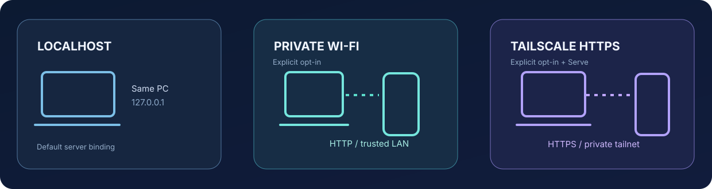

# AirCursor

### Control your computer beyond the keyboard and mouse.

**One desktop. Four ways to interact.**  
A secure, multi-modal desktop control system powered by a phone, motion sensors, webcam-based computer vision and voice commands.

  
  
  

  
  
  
  
  
  
  

**Touchpad** &nbsp;·&nbsp; **Phone Motion** &nbsp;·&nbsp; **Hand Gestures** &nbsp;·&nbsp; **Voice Control**

[Overview](#overview) · [Features](#features) · [How it works](#how-it-works) · [Installation](#getting-started) · [Tech stack](#technology-stack) · [API](#rest-api) · [Troubleshooting](#troubleshooting)

---

## Overview

AirCursor transforms everyday devices into intuitive interfaces for desktop interaction. A phone becomes a wireless touchpad or motion-driven air mouse; a webcam translates hand landmarks into pointer gestures; and supported voice commands trigger a restricted set of desktop actions.

The computer runs a lightweight Python/Flask service that accepts authenticated browser commands and maps them to mouse and keyboard events through PyAutoGUI. Camera-based gesture tracking runs separately on the computer, keeping webcam processing local.

**AirCursor is an input-control system, not a remote-desktop streaming application.** It sends defined control actions rather than streaming the screen or allowing arbitrary remote shell commands.

### The problem it solves

| Common limitation | How AirCursor addresses it |
|---|---|
| A keyboard and mouse are inconvenient during presentations | Use phone-based slide controls without returning to the computer |
| Media playback requires walking to the laptop | Control playback, volume and cursor from a paired device |
| Touchless interfaces usually need dedicated hardware | Experiment with webcam hand tracking using an existing camera |
| Conventional mobile remotes need an installed phone app | Open the responsive interface directly in a browser |
| Motion-control experiments need sensor-to-pointer integration | Calibrate phone orientation and map tilt to relative cursor movement |
| Browser-to-desktop control needs clear boundaries | Pair with a PIN and use only allowlisted desktop actions |

## Features

| Input mode | How it works | Available interactions |
|---|---|---|
| **Mobile touchpad** | Browser touch events become relative pointer commands | Move, tap, double-click, right-click, scroll |
| **Motion air mouse** | Device orientation is calibrated and converted into bounded cursor deltas | Tilt-to-move, recalibration, sensitivity adjustment |
| **Webcam hand tracking** | MediaPipe landmarks are interpreted using configurable gesture rules | Cursor movement, pinch clicks, scrolling, optional dwell click |
| **Voice commands** | Browser speech recognition is matched against defined phrases | Presentation, playback, volume and selected pointer actions |
| **Presentation and media panel** | Dedicated dashboard controls dispatch named keyboard actions | Next/previous slide, play/pause, volume, mute, Enter, Escape |

### Practical capabilities

- **Browser-first operation:** no native mobile app required for touch and motion control.
- **Six-digit pairing:** the host displays a PIN before authorizing control requests.
- **Connection flexibility:** localhost, trusted private Wi-Fi, or private HTTPS via Tailscale Serve.
- **Customizable input:** touch and motion sensitivity, hand-gesture parameters and interaction profiles.
- **Readable control boundaries:** requests map to known actions rather than arbitrary commands.
- **Local webcam processing:** hand-tracking frames are processed on the host computer.
- **Testable components:** API/security tests, sensor-mapping tests and voice-command parsing tests.

---

## System architecture

AirCursor separates input capture, interpretation, authenticated transport and desktop actuation. Phone controls share one server-side input API; the webcam controller has its own local processing path.

~~~mermaid
flowchart LR
  subgraph PHONE["MOBILE BROWSER"]
    TOUCH["Touchpad and buttons"]
    MOTION["Orientation sensors"]
    VOICE["Speech recognition"]
    CLIENT["Command controller"]
    TOUCH --> CLIENT
    MOTION --> CLIENT
    VOICE --> CLIENT
  end

  subgraph TRANSPORT["PRIVATE CONNECTION"]
    LAN["Trusted Wi-Fi / HTTP"]
    TS["Tailscale Serve / HTTPS"]
  end

  subgraph HOST["WINDOWS COMPUTER"]
    FLASK["Flask web dashboard"]
    PAIR["PIN pairing + sessions"]
    API["Validated REST API"]
    INPUT["PyAutoGUI input driver"]
    FLASK --> PAIR --> API --> INPUT
  end

  subgraph VISION["OPTIONAL LOCAL VISION"]
    CAMERA["Webcam / OpenCV"]
    LANDMARKS["MediaPipe Hands"]
    GESTURES["Gesture mapping and smoothing"]
    LOCALINPUT["PyAutoGUI"]
    CAMERA --> LANDMARKS --> GESTURES --> LOCALINPUT
  end

  CLIENT --> LAN --> API
  CLIENT --> TS --> API
  INPUT --> DESKTOP["Desktop pointer and shortcuts"]
  LOCALINPUT --> DESKTOP

  classDef mobile fill:#163B5C,stroke:#56C7F3,stroke-width:2px,color:#F0FAFF;
  classDef network fill:#43306B,stroke:#B79DFF,stroke-width:2px,color:#FFFFFF;
  classDef host fill:#123F3E,stroke:#61DCC4,stroke-width:2px,color:#F0FFF9;
  classDef vision fill:#2C376B,stroke:#91B6FF,stroke-width:2px,color:#F7FAFF;
  classDef desktop fill:#075E65,stroke:#22DBCD,stroke-width:3px,color:#FFFFFF;
  class TOUCH,MOTION,VOICE,CLIENT mobile;
  class LAN,TS network;
  class FLASK,PAIR,API,INPUT host;
  class CAMERA,LANDMARKS,GESTURES,LOCALINPUT vision;
  class DESKTOP desktop;
~~~

**Architecture boundary:** the phone cannot directly call PyAutoGUI. Browser requests pass through Flask's pairing, session, host and input-validation checks. Webcam gestures are processed by a separate program started on the computer.

### How it works

~~~mermaid
sequenceDiagram
  autonumber
  actor User
  participant Phone as Mobile browser
  participant Server as Flask API
  participant Driver as PyAutoGUI
  participant Desktop as Computer

  User->>Server: Start AirCursor
  Server-->>User: Display control URL and pairing PIN
  User->>Phone: Open dashboard and enter PIN
  Phone->>Server: POST /api/v1/pair
  alt PIN accepted
    Server-->>Phone: Protected session cookie
    User->>Phone: Touch, tilt or select action
    Phone->>Server: Authenticated control request
    Server->>Server: Validate session, origin and input
    Server->>Driver: Execute allowlisted action
    Driver->>Desktop: Mouse / keyboard event
    Server-->>Phone: API response
  else PIN rejected
    Server-->>Phone: Rejection / attempt limit
  end
~~~

### Input-processing model

~~~mermaid
flowchart TB
  A["Incoming input"] --> B{"Input source?"}
  B -->|Touch| C["Calculate pointer delta / touch gesture"]
  B -->|Phone motion| D["Calibrate → dead zone → sensitivity → clamp"]
  B -->|Webcam| E["Detect hand landmarks → recognize gesture → smooth"]
  B -->|Voice| F["Recognize phrase → match approved action"]
  C --> G["Relative mouse / click / scroll request"]
  D --> G
  F --> G
  G --> H["Authenticated Flask control API"]
  H --> I["PyAutoGUI desktop event"]
  E --> J["Local PyAutoGUI desktop event"]

  classDef raw fill:#152B4F,stroke:#68C2FF,color:#FFFFFF;
  classDef processing fill:#334371,stroke:#9DA9FF,color:#FFFFFF;
  classDef secure fill:#155646,stroke:#6BE5BB,color:#FFFFFF;
  classDef output fill:#654A1B,stroke:#FFD06D,color:#FFFFFF;
  class A,B raw;
  class C,D,E,F,G processing;
  class H secure;
  class I,J output;
~~~

---

## Getting started

### Requirements

- A Windows computer with **Python 3.11 recommended**, Git and pip.
- A modern browser on the computer or phone.
- For phone control: a trusted private Wi-Fi network or Tailscale.
- For webcam gestures: webcam access plus optional OpenCV and MediaPipe dependencies.
- For motion or speech: compatible phone/browser permissions, typically requiring HTTPS.

### Install and run on Windows

Open **Command Prompt (CMD)**:

~~~cmd
git clone https://github.com/pushkkal0201-bit/Air_Cursor.git
cd Air_Cursor

py -3.11 -m venv .venv
.venv\Scripts\activate

python -m pip install --upgrade pip
python -m pip install -r requirements.txt

python app.py
~~~

By default, AirCursor listens on **http://127.0.0.1:5055**, accessible from the computer itself.

### Pair a phone

1. Start the server using one of the connection options below.
2. Open its dashboard address on the phone, or scan the QR code.
3. Enter the **six-digit PIN shown in the computer terminal**.
4. Once paired, use the touchpad, action buttons or supported phone sensor controls.

To stop the service, return to CMD and press **Ctrl+C**.

## Connection options

| Connection | Command | Recommended use | Security consideration |
|---|---|---|---|
| **Local computer** | `python app.py` | Development, single-device demonstrations | Accessible through loopback |
| **Trusted Wi-Fi** | `python app.py --lan` | Phone touchpad on a private LAN | Plain HTTP; not encrypted |
| **Tailscale HTTPS** | `python app.py --tailscale-host HOSTNAME` | Private phone access with motion and voice | Tailnet access controls plus TLS |
| **Local HTTPS** | `python app.py --https` | Local TLS testing | Self-signed certificate; browser trust limitations |

### Private HTTPS using Tailscale Serve

A secure browser context is commonly required for phone orientation sensors and speech APIs. Tailscale Serve supplies an HTTPS endpoint inside your private tailnet without making the dashboard a public website.

**On the computer**, connect Tailscale, then run:

~~~cmd
tailscale serve --bg 5055
tailscale serve status
~~~

Use the exact hostname shown by `tailscale serve status`:

~~~cmd
python app.py --tailscale-host DEVICE.YOUR-TAILNET.ts.net
~~~

**On the phone**, join the same authorized tailnet, open its HTTPS address, and pair using the PIN. For motion control, tap **Enable motion**, allow sensor access when requested and calibrate.

> **Do not enable Tailscale Funnel or public port forwarding for AirCursor.** Tailscale Serve is intended for private tailnet access. In this mode the Flask backend remains bound to localhost.

---

## Using AirCursor

### 1. Mobile touchpad

The phone's browser becomes a trackpad. Touch movement is processed into relative cursor deltas instead of requiring the user to know desktop-screen coordinates.

| Gesture | Action |
|---|---|
| Slide a finger | Move cursor |
| Tap | Left click |
| Double tap | Double click |
| Long press | Context/right-click behavior |
| Two-finger movement | Scrolling |
| On-screen media buttons | Predefined playback and slide shortcuts |

Sensitivity and interaction preferences can be adjusted through the dashboard.

### 2. Motion-controlled air mouse

AirCursor uses browser orientation readings to turn the phone into a calibrated motion input.

~~~mermaid
flowchart LR
  SENSOR["DeviceOrientation readings"] --> CAL["Capture neutral angle"]
  CAL --> DELTA["Compute tilt difference"]
  DELTA --> DEAD["Apply dead zone"]
  DEAD --> GAIN["Sensitivity scaling"]
  GAIN --> CAP["Bound movement"]
  CAP --> API["Relative cursor API"]
  API --> CURSOR["Desktop pointer"]

  classDef sensing fill:#243F6C,stroke:#91C3FF,color:#FFFFFF;
  classDef math fill:#354C76,stroke:#B6B9FA,color:#FFFFFF;
  classDef action fill:#14564D,stroke:#7EE2BC,color:#FFFFFF;
  class SENSOR,CAL sensing;
  class DELTA,DEAD,GAIN,CAP math;
  class API,CURSOR action;
~~~

**How to use it:** open the HTTPS dashboard, enable motion permissions, hold the phone in a comfortable neutral position, tap **Calibrate**, then tilt to move the cursor. Recalibration and sensitivity adjustments help reduce unintended movement.

Motion behavior depends on device sensors, permissions and browser support; touchpad mode remains available where orientation data is unavailable.

### 3. Webcam hand gestures

The optional webcam controller runs **locally on the computer**, independently of the phone dashboard.

Install the computer-vision dependencies:

~~~cmd
python -m pip install -r requirements-vision.txt
python gesture_control.py
~~~

Supported gesture processing includes fingertip position, palm-relative pinch thresholds, smoothing, scrolling and configurable click mappings. An optional dwell-click behavior can be enabled through the gesture configuration.

The main gesture settings are stored in `gesture_config.json`:

~~~json
{
  "camera": 0,
  "smoothing": 0.28,
  "pinch_threshold": 0.32,
  "scroll_speed": 24,
  "gesture_actions": {
    "index_pinch": "left_click",
    "middle_pinch": "right_click"
  },
  "deadzone_pixels": 3,
  "dwell_click_seconds": 0
}
~~~

A well-lit webcam view and unobstructed hand tracking improve reliability. Close the local gesture window with **Q** or **Escape**.

### 4. Voice and presentation controls

In supported browsers, the dashboard provides push-to-talk recognition. Transcribed speech is matched against **predefined phrases** rather than treated as an arbitrary desktop command.

Available action categories include slide navigation, playback, volume, mute, clicking and scrolling. The on-screen presentation/media controls offer the same type of actions without needing a microphone.

**Privacy note:** speech recognition is provided by the browser and may involve an external speech service; AirCursor does not claim to provide an offline speech-recognition model.

---

## Security & privacy

Because remote input affects real desktop applications, AirCursor applies authorization and validation before acting on browser commands.

~~~mermaid
stateDiagram-v2
  [*] --> Unpaired
  Unpaired --> Pairing : Submit PIN
  Pairing --> Paired : PIN valid
  Pairing --> Unpaired : Incorrect PIN
  Pairing --> RateLimited : Repeated failures
  RateLimited --> Unpaired : Lockout expires
  Paired --> Paired : Authorized action
  Paired --> Unpaired : Logout / session expiry
  Paired --> Unpaired : Server restarts
~~~

| Safeguard | Implementation |
|---|---|
| Pairing | Six-digit PIN displayed by the computer |
| Session control | One-hour session expiry and bounded in-memory sessions |
| Brute-force resistance | Per-IP pairing-attempt limits |
| Session cookies | `HttpOnly`, `SameSite=Strict` and secure-cookie behavior on HTTPS |
| Browser request checks | Same-origin enforcement for protected writes |
| Client request identification | `X-AirCursor-Client: 1` on state-changing requests |
| Trusted hosts | Loopback/private addresses or an explicitly configured Tailscale hostname |
| Input validation | Bounded JSON inputs, permitted mouse buttons and allowlisted actions |
| Browser headers | Restrictive response and content-security headers |
| Desktop safety | PyAutoGUI corner fail-safe enabled |
| Execution scope | No arbitrary remote shell commands through the REST API |

**Security boundaries:** PIN pairing does not encrypt ordinary LAN HTTP traffic. Use `--lan` only on networks you trust, and prefer private HTTPS for phone sensors and microphones. Only use AirCursor to control a computer you own or are authorized to operate.

## REST API

The dashboard communicates with a constrained HTTP API. Protected endpoints require a valid paired session, and write requests are subject to additional validation.

| Method | Endpoint | Description |
|---|---|---|
| `GET` | `/api/v1/status` | Service and pairing state |
| `POST` | `/api/v1/pair` | Exchange PIN for a browser session |
| `POST` | `/api/v1/logout` | Revoke current session |
| `GET` | `/api/v1/cursor` | Read cursor position |
| `PUT` | `/api/v1/cursor` | Set cursor coordinates |
| `PATCH` | `/api/v1/cursor` | Apply relative pointer movement |
| `POST` | `/api/v1/click` | Perform a supported click |
| `POST` | `/api/v1/scroll` | Scroll |
| `POST` | `/api/v1/action` | Execute a named presentation/media action |

Example relative cursor command (requires a valid paired session):

~~~http
PATCH /api/v1/cursor HTTP/1.1
Content-Type: application/json
X-AirCursor-Client: 1

{"dx":12,"dy":-8}
~~~

The session cookie is managed by the browser, not read directly by the dashboard's JavaScript.

---

## Technology stack

| Layer | Technologies | Responsibility |
|---|---|---|
| **Desktop backend** | Python, Flask, Werkzeug | Local web service, pairing, endpoints, session and request controls |
| **Input automation** | PyAutoGUI | Mouse movement, clicks, scrolling and keyboard/media actions |
| **Web application** | HTML, CSS, JavaScript | Responsive phone dashboard, settings and command dispatch |
| **Computer vision** | OpenCV, MediaPipe Hands | Webcam capture and hand-landmark detection |
| **Motion sensing** | DeviceOrientation API | Phone orientation and tilt input |
| **Voice interaction** | Browser speech recognition APIs | Supported phrase-to-action mapping |
| **Network access** | HTTP, Tailscale Serve, HTTPS | Trusted-LAN and tailnet-based connectivity |
| **Device onboarding** | qrcode, Pillow | QR code for the dashboard address |
| **Testing** | pytest, Node.js test runner, GitHub Actions | Backend, sensor, voice and integration checks |
| **Windows distribution** | PyInstaller, Inno Setup | Portable executable and installer workflows |

## Project structure

~~~text
Air_Cursor/
├── app.py                           # Application entry point
├── gesture_control.py               # Webcam gesture controller
├── gesture_config.json              # Gesture preferences
├── requirements.txt                 # Core dependencies
├── requirements-vision.txt          # Optional vision dependencies
├── pyproject.toml                   # Python package configuration
├── src/aircursor/
│   ├── cli.py                       # Launch and connection arguments
│   ├── server.py                    # Flask API and session security
│   ├── airmouse.py                  # PyAutoGUI desktop actions
│   ├── templates/index.html         # Browser dashboard
│   └── static/
│       ├── touchpad.js              # Touch/motion input
│       ├── motion_math.js           # Orientation-to-pointer math
│       ├── voice_commands.js        # Speech phrase mapping
│       └── advanced.js              # Voice UI and control preferences
├── tests/                           # Python + JavaScript tests
├── scripts/                         # Diagnostic and benchmark tools
├── installer/                       # Windows installer definition
├── docs/assets/                     # Project SVG graphics
└── .github/workflows/              # Automated build and validation
~~~

## Testing and packaging

### Automated checks

~~~cmd
python -m pip install "pytest>=8,<10"
python -m pytest -q

node --test tests/voice.test.cjs tests/motion.test.cjs
~~~

Optional syntax checks:

~~~cmd
node --check src/aircursor/static/touchpad.js
node --check src/aircursor/static/motion_math.js
node --check src/aircursor/static/voice_commands.js
node --check src/aircursor/static/advanced.js
~~~

The repository also includes an API microbenchmark:

~~~cmd
python scripts/benchmark_api.py --requests 500
~~~

This is a headless service-level benchmark using a simulated mouse; it **does not** measure end-to-end phone latency or real-world gesture accuracy.

### Windows application

The repository includes Windows packaging scripts for a portable executable and installer, with corresponding GitHub Actions workflows. Successful workflow artifacts can be obtained from the [Actions tab](https://github.com/pushkkal0201-bit/Air_Cursor/actions); availability depends on the status of each workflow run.

---

## Where AirCursor is useful

| Scenario | Benefit |
|---|---|
| **Classroom presentations** | Move through slides without standing next to the laptop |
| **Meetings and demonstrations** | Drive presentations from a paired phone |
| **Media control** | Play, pause and adjust volume from across a room |
| **Computer-vision learning** | Explore landmark tracking and gesture-to-action mapping |
| **Motion-interface experiments** | Test device orientation, calibration and input smoothing |
| **Flexible interaction** | Switch between touch, motion, gestures and supported voice commands |

## Troubleshooting

| Issue | Suggested resolution |
|---|---|
| Phone cannot reach dashboard | Use `--lan` on trusted Wi-Fi or configure private Tailscale Serve |
| Pairing rejected | Enter the current PIN shown on the computer |
| Session stopped working | Pair again after session expiry or server restart |
| Phone motion says *permission denied* | Open the HTTPS Tailscale URL and request motion access from the dashboard button |
| Motion produces no input | Check device/browser sensor support, permission settings and calibration |
| Webcam unavailable | Check camera permission and the `camera` index in `gesture_config.json` |
| Gesture tracking is unstable | Improve lighting and tune smoothing/dead-zone settings |
| Voice control is unavailable | Check browser speech recognition and microphone permissions |
| Tailscale page returns a host error | Verify the exact device hostname matches `--tailscale-host` |

## Important limitations

AirCursor does not provide desktop video streaming, file transfer or arbitrary command execution. The webcam controller must be started separately; mobile browsers and phone sensors differ in capability. Sensor and speech permissions may require HTTPS, and image-tracking quality depends on lighting and camera placement. The project should not be exposed to the public internet or treated as a certified accessibility or security product.

## License

Distributed under the [MIT License](LICENSE). See the license file for the full terms and copyright notices, which must be preserved when redistributing the software.

---

### AirCursor
**One desktop. Four ways to interact.**

**Touch · Motion · Vision · Voice**

[Back to top](#aircursor) · [Source code](https://github.com/pushkkal0201-bit/Air_Cursor) · [Issues & feedback](https://github.com/pushkkal0201-bit/Air_Cursor/issues)

